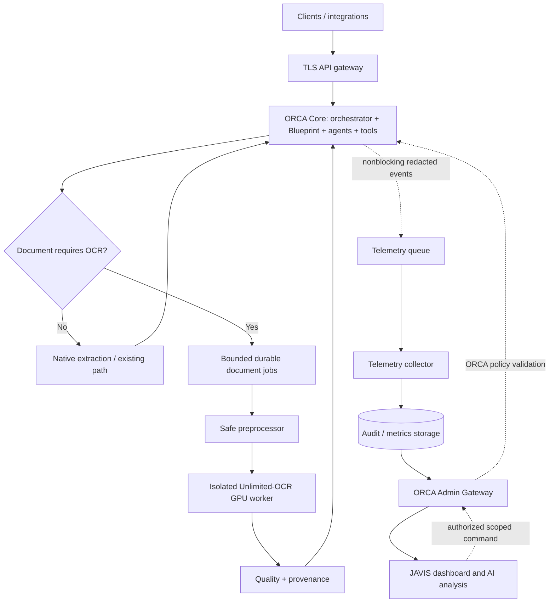

# MASTER ARCHITECTURE SPEC — ORCA Core + JAVIS OS + Unlimited-OCR
Status: PROPOSED / DISCOVERY GATE OPEN. Date: 2026-10-24.
Scope: ORCA CORE service only; explicitly excludes orca_erp.
Related: docs/integrations/orca-unlimited-ocr-plan.md

## Mission
Build an additive, reversible administrative intelligence and document-processing extension. ORCA remains sole authority for orchestration, agents, model routing, MCP tools, workflows, Blueprint execution, context and memory. JAVIS is a read-only-by-default administration plane. Unlimited-OCR is an optional, isolated document tool. No existing ORCA capability may be removed, replaced or degraded.

## Mandatory discovery before any implementation
1. Locate the **actual deployed ORCA Core**, source repository, revision, containers, runtime, ingress and environment. Do not assume Orca-claude-code contains Blueprint; do not use orca_erp.
2. Inventory every integration, model provider, agent, MCP connector, workflow, Blueprint definition/executor, job scheduler, data store and published API. Build capability-to-test matrix.
3. Capture baseline latency, throughput, error rate, costs, queue depth, memory and resource budgets; run existing tests and produce reproducible evidence.
4. Identify data classification, tenants, deployment permissions, available GPU/CUDA/VRAM, secret store, TLS and rollback procedure. Block code changes if critical facts remain unknown.

## Logical planes and ownership
- Execution plane: ORCA Core orchestrator, Blueprint, agent/model router, integrations, existing tools, workflows; unchanged contracts.
- Administration plane: JAVIS UI + dedicated ORCA Admin Gateway + telemetry collector. Read-only first. Authorized commands require ORCA policy enforcement, explicit approval, idempotency, audit and RBAC.
- Document plane: document router -> native-text fast path OR bounded queue -> safe PDF/image preprocessor -> OCR inference (choose SGLang OR vLLM based on benchmark) -> quality guard -> versioned structured results. Tool invocation is ORCA-owned.
- Data plane: PostgreSQL for admin metadata if needed, Redis Streams for durable event/jobs if justified, S3-compatible storage for large encrypted document artifacts if needed. No new mandatory stateful service without ADR and sizing.

## Reference topology

Use separate Docker networks: edge, execution, admin, document, data. Only edge ingress is externally reachable. OCR model endpoint, databases, Redis and host Docker socket are never public.

## Proposed repository layout (do not move existing directories blindly)
```
getupsoft_workspace/
  orca-core/ [existing, discovered]
    extensions/document_intelligence/{contracts,router,adapters,tools,tests}
  javis-os/ [existing]
    integrations/orca_admin/{api_client,analytics,audit,blueprint_viewer,ocr_monitor,tests}
  orca-platform-infra/ [new only after approval]
    deploy/{compose,environments,reverse-proxy}
    services/{admin-gateway,telemetry-collector,document-worker,ocr-inference}
    contracts/{openapi,events,protobuf}
    observability/{otel,prometheus,grafana,loki}
    security/{rbac,policies,threat-model,sbom}
    benchmarks/{corpus,results}
    tests/{contract,integration,regression,performance,security,chaos}
    scripts/
    docs/{architecture,adr,runbooks,disaster-recovery}
```

## Dependency bill of materials (pin exact versions after compatibility verification)
| Dependency | Purpose | Classification |
|---|---|---|
| Docker Engine / Compose | isolated deployment | required for proposed deployment |
| Existing ORCA runtime | preserve as-is | required |
| Python compatible with service, uv | new Python adapters | required for Python implementation |
| FastAPI, Pydantic v2, httpx | admin gateway, typed clients | required if new gateway built in Python |
| PyMuPDF | native PDF extraction + rasterization | required for PDF support |
| Unlimited-OCR model + reviewed code | OCR inference | required for OCR feature |
| PyTorch + CUDA compatible drivers | local NVIDIA inference | conditional |
| SGLang OR vLLM | GPU inference server | choose one via benchmark |
| Pillow, safetensors, transformers | backend-dependent model support | conditional |
| Redis Streams | queues and backpressure | conditional; reuse existing broker where possible |
| PostgreSQL | audit metadata and job state | conditional; reuse managed database where possible |
| S3/MinIO | large documents/results | conditional |
| OpenTelemetry, Prometheus, Grafana | traces and metrics | recommended |
| Loki | centralized logs | optional |
| Existing OIDC or Keycloak | admin authentication | conditional |
| Existing Nginx/Cloudflare Tunnel | TLS ingress | conditional |
| pytest, Ruff, typing checks | QA | required |
| k6/Locust | load and soak tests | recommended |
| Trivy, pip-audit, SBOM generator | dependency and container security | recommended |
All runtime dependencies require lockfiles, pinned image digests, vulnerability and license review. Never run model code with trust_remote_code=True before source review and revision pinning. Verify model weights' license separately from the repo's MIT code license.

## Proposed API contracts — not yet implemented
- GET /v1/admin/requests (scoped metadata)
- GET /v1/admin/traces/{trace_id} (RBAC-filtered correlation)
- GET /v1/admin/blueprints/{blueprint_id} (read-only, via ORCA)
- POST /v1/documents/jobs (ORCA-authorized only)
- GET /v1/documents/jobs/{job_id} (tenant-scoped)
- POST /v1/admin/actions (disabled until approved authorization phase)
- GET /health/live and /health/ready (each service)
Define versioned OpenAPI schemas, error types, trace/request/job identifiers, idempotency keys, pagination, deadlines and cancellation semantics. Do not expose raw document content in telemetry.

## Event schema (proposed)
```json
{
  "schema_version":"1.0", "event_id":"uuid", "trace_id":"uuid",
  "request_id":"uuid", "timestamp":"UTC ISO-8601",
  "source":"orca-core", "event_type":"document.job.completed",
  "actor_id":"pseudonymous-id", "tenant_id":"scoped-id",
  "blueprint_id":null, "workflow_id":null, "job_id":"uuid",
  "duration_ms":1234, "status":"completed", "error_code":null
}
```
Use schema validation, event de-duplication, replay, bounded buffering, dead-letter queue and explicit telemetry drop counters.

## Security requirements
mTLS or equivalent service identity, OIDC + RBAC for admins, least privilege, secrets outside git, encryption at rest and in transit, tenant isolation, no public OCR port, no Docker socket, input MIME/signature checks, page/pixel/size/time limits, PDF sandbox, malware checks where appropriate, OCR output as untrusted data, retention policy and redaction of PII, credentials and prompts. AI suggestions never execute production changes autonomously.

## Work breakdown and acceptance
Phase 0: discovery, ADRs, inventories, architecture baseline and critical regression tests.
Phase 1: nonblocking telemetry adapter and read-only Admin Gateway.
Phase 2: JAVIS dashboard, traces, incidents and read-only Blueprint explorer.
Phase 3: OCR benchmark and dependency/hardware/license/security approval.
Phase 4: optional OCR adapter, document router, bounded queue, structured parser and quality guard; preserve native-text fast path.
Phase 5: OCR dashboards and evidence-backed administrative AI recommendations.
Phase 6: authorization-controlled admin actions, only after threat modeling and approvals.
Phase 7: QA, security tests, load/soak/chaos, canary, rollback rehearsal and staged production release.

Tests: ORCA + Blueprint critical contract suite 100% passing, zero regressions, ORCA operates when JAVIS/OCR/telemetry are down, no non-OCR request blocked by OCR queue, accurate page accounting, deterministic job lifecycle, no unauthorized actions, latency/throughput improvements verified against representative corpus (do not invent speedups), secret and document privacy preserved. Propose p95 telemetry overhead <=5ms subject to baseline confirmation; coverage target >=99.9% eligible requests; verify sustained throughput and queue saturation.

## Multiagent work policy
Architecture/security/production/high-risk: Sol if available. Bounded coding, QA, docs: Terra if available. Repetitive inventories: Luna if available. No parallel edits to same files. Astra, if available, is independent **final** reviewer only: APROBADO / INCOMPLETO / BLOQUEADO with evidence gaps. If model delegation unavailable, do not pretend it occurred.

## Definition of done
Evidence: architecture diagrams + ADRs, dependency lock/SBOM, OpenAPI and event schemas, CI logs, regression matrix, GPU benchmark report, security report, deployment/rollback runbooks and independent final acceptance. Until actual ORCA Core/Blueprint source and production topology are verified, implementation is BLOCKED at Phase 0. No production deployment authorized.
