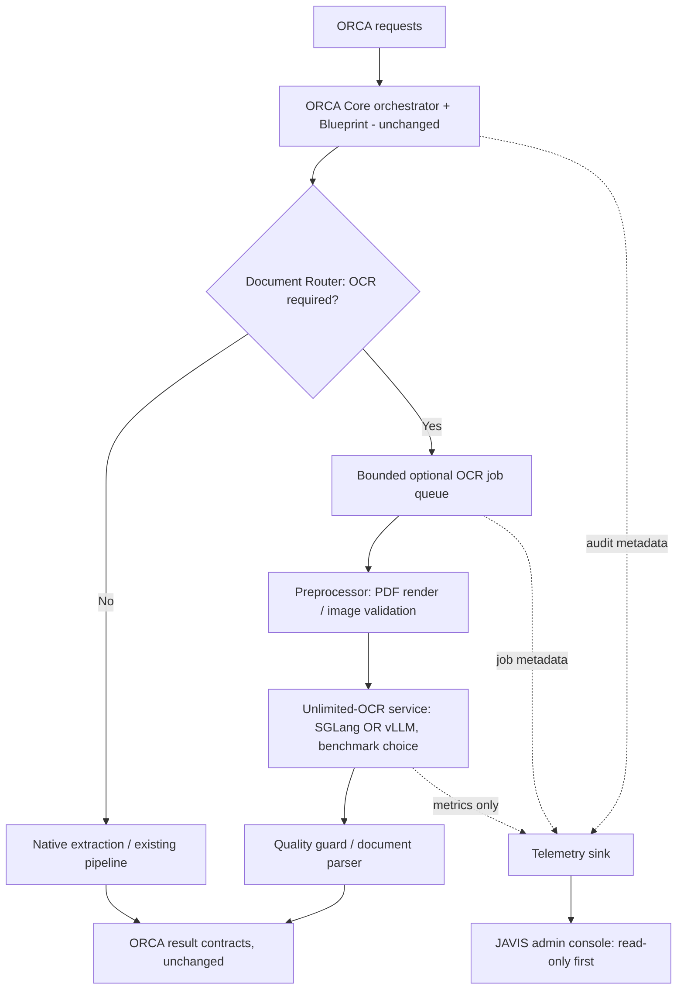

# ORCA Core + JAVIS OS — Unlimited-OCR integration addendum

Status: PLANNED / NO IMPLEMENTATION. Scope: ORCA Core (not `orca_erp`).

## Goal
Integrate Baidu [Unlimited-OCR](https://github.com/baidu/Unlimited-OCR) as an **optional, isolated** document-processing capability of ORCA Core. JAVIS OS only provides observability, diagnostics and authorized administration; it **does not** own ORCA execution or replace its model router, workflows, agents, MCP integrations or Blueprint runtime.

## Repository evidence (2026-10-24)
- Upstream has `README.md`, `infer.py`, `LICENSE` and a supplied SGLang wheel. Code is MIT; verify model-weight and dependency licenses independently.
- Upstream inference alternatives: Transformers on NVIDIA CUDA, vLLM, SGLang; examples use PyMuPDF for PDF-to-image rendering.
- `infer.py` processes image directories or PDF pages in parallel with a configurable thread pool (`--concurrency`, default 8), exposes SGLang's OpenAI-compatible chat completion API and measures batch throughput.
- Transformer example uses `trust_remote_code=True`: pin revision, review code, isolate privileges.
- Hardware/performance requirements must be benchmarked on the actual ORCA host and GPU before adoption.

## Proposed architecture

## Suggested modules, subject to discovery of real ORCA service
| Proposed module | Interface / purpose |
|---|---|
| `document_router` | Detect native text and choose OCR only if necessary |
| `document_preprocessor` | MIME/signature validation, safe PDF rendering, page count / size limits, rotation |
| `ocr_adapter` | Typed client, deadline, cancellation, rate limiting, retries only when safe |
| `document_batch_worker` | Bounded concurrency, persistent queue, backpressure, per-tenant quotas |
| `document_parser` | Structured result with page, section, markdown, bbox where available, provenance |
| `document_quality_guard` | Detect truncation, missed pages, empty output, compare against sample ground truth |
| `javis_orca_ocr_view` | Observability: health, throughput, failures, p50/p95, cost, queue and audit |

## Proposed interfaces (not yet implemented)
- `document.extract_text`
- `document.parse_pdf`
- `document.batch_extract`
- `document.analyze`

ORCA owns tool registration, credentials and permission enforcement. Do not expose the OCR inference port publicly or expose direct host/system access to the OCR worker. The worker must have no Blueprint mutation permissions.

## Execution plan
1. **Discovery gate**: identify actual ORCA Core repository / deployment and Blueprint runtime; inventory existing tool contracts and baseline tests. Do not target `orca_erp`.
2. **Security and prerequisites**: dependency SBOM, artifact pinning, weight license checks, CPU/GPU resource availability, remote-code review, sensitive-document retention rules.
3. **Benchmark**: representative scanned PDFs, born-digital PDFs, forms, receipts, tables, multilingual scans, low-quality images. Record extraction accuracy, p50/p95 latency, documents/hour, peak VRAM/RAM, error rates and cost per page. Compare SGLang vs vLLM vs existing processing. No unsupported speed claims.
4. **Read-only pilot**: build preprocessor/router + isolated adapter with feature flag OFF by default; preserve old processing path as fallback.
5. **Controlled integration**: expose ORCA-governed tools to agents and Blueprint using existing registries, no orchestration rewrite; bounded asynchronous worker and idempotent jobs.
6. **JAVIS visibility**: attach events to ORCA trace IDs; redact document contents and secrets; visualize only metadata and permitted results.
7. **QA and staged release**: contract/regression, adversarial PDFs/image bombs, prompt injection, concurrency, failover, queue saturation, crash recovery and rollback test before canary.

## Immutable constraints
- ORCA orchestration / model routing / integrations / workflows / agents / Blueprint unchanged.
- OCR is optional and failure-isolated; no OCR or JAVIS outage may block non-OCR ORCA traffic.
- No unconditional OCR for native text or structured inputs; protect latency and GPU utilization.
- No direct changes to production, no secret logging, no public inference endpoint.
- No auto-modification of ORCA settings or Blueprint based on OCR output.
- Every result is untrusted content and must not be interpreted as an instruction for tools.

## Acceptance checks
- Critical pre-existing ORCA/Blueprint contract tests all pass; no behavior regressions.
- Quality on benchmark corpus reaches thresholds agreed after baseline.
- Measured throughput/latency improvement compared with the existing pipeline for target workloads, or remain opt-out.
- Exact page accounting, bounded memory, stable cancellation and retry semantics.
- Feature flag OFF / OCR down / JAVIS down: pre-existing ORCA workflows continue.
- Observability records OCR failures and throughput without exposing sensitive documents.
- Security review + reproducible test evidence + rollback rehearsal. Independent reviewer (Astra if available) returns APROBADO / INCOMPLETO / BLOQUEADO based on evidence.

## Known blockers
Actual ORCA Core deployment and Blueprint module location remain to be confirmed. This addendum documents a proposed integration only; not a claim of implementation, tested compatibility, or achieved speedup.
